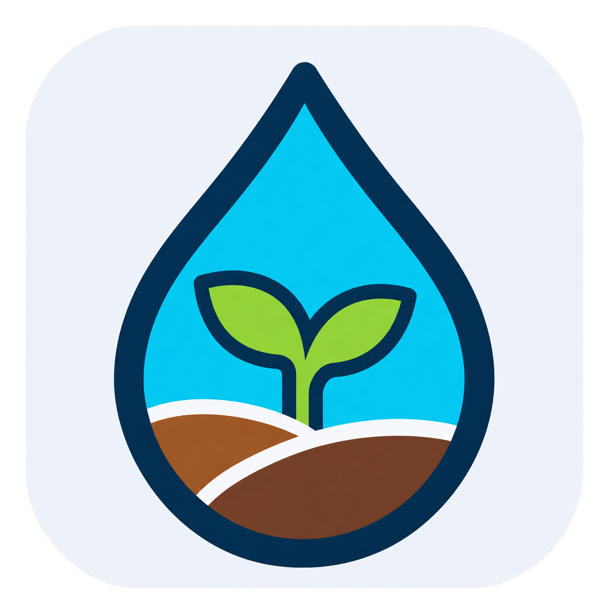

# WetSoil – Wetterabhängige Bewässerung für Home Assistant



Das WetSoil-Logo verbindet **Wasser** (blauer Tropfen), **Boden** (braune Erdschichten) und **Pflanzenwachstum** (grüner Keimling). Die freigegebene Grafik wird als Integrationsicon (`custom_components/wetsoil/brand/icon.png`) und als hochauflösendes Dokumentationsbild (`docs/wetsoil-logo.png`) verwendet. Die überarbeiteten Grafiken mit **transparentem Hintergrund** sind in **0.1.3** enthalten.

**WetSoil** steuert unabhängige Bewässerungskreise anhand von Wetterprognosen, tatsächlich gemessenem Niederschlag und frei konfigurierbaren Zeitplänen. Die Einstellungen und die Überwachung erfolgen über eine mitgelieferte Dashboard-Card.

**Status: Experimentell.** Der zugrunde liegende Bewässerungsalgorithmus wurde über viele Jahre privat verwendet und weiterentwickelt. Die Home-Assistant-Integration ist neu, wurde in erheblichem Umfang mit KI-Unterstützung erstellt und befindet sich weiterhin in der Erprobung. Sie ist **kein zertifizierter Bewässerungs- oder Sicherheitscontroller**.

[English / Hauptdokumentation](../README.md) · [Architektur](architecture.md) · [Issues](https://github.com/derhopp/WetSoil/issues) · [CI](https://github.com/derhopp/WetSoil/actions)

## Installation über den Home Assistant Marketplace

Der in Home Assistant 2026.11 integrierte **Marketplace** ist der Nachfolger von HACS. Solange WetSoil nicht im öffentlichen Katalog gelistet ist:

1. **Einstellungen → Marketplace** öffnen und **Über Link hinzufügen** auswählen.
2. **https://github.com/derhopp/WetSoil** als Repository-Adresse verwenden, anschließend die Integration installieren.
3. **Home Assistant neu starten**.
4. **Einstellungen → Geräte & Dienste → Integration hinzufügen → WetSoil** öffnen.
5. Ausschließlich **Name** und einen vorhandenen **Bereich (Area)** auswählen. Pro Bewässerungskreis eine eigene Instanz anlegen.
6. Im Dashboard die Card `custom:wetsoil-card` hinzufügen und die gewünschte Instanz auswählen.

Die Card befindet sich im selben Repository und benötigt keine separate Installation. Bei **über die Home-Assistant-Oberfläche verwalteten Dashboard-Ressourcen** registriert WetSoil das JavaScript-Modul beim Einrichten der Integration automatisch, prüft die Registrierung nach dem Home-Assistant-Start erneut und aktualisiert die Ressource bei Änderungen an der mitgelieferten Card.

### Automatische Dashboard-Ressource

| Ressourcenverwaltung | Verhalten |
| --- | --- |
| **Über Home Assistant verwaltet (Storage-Modus)** | WetSoil erstellt oder aktualisiert automatisch **genau einen** JavaScript-Modul-Eintrag; andere Ressourcen bleiben unverändert |
| **YAML-verwaltet oder schreibgeschützt** | Keine automatische Änderung; Ressource muss **manuell** eingetragen werden |

**Prüfung:** Nach Installation und Home-Assistant-Neustart in der Ressourcenverwaltung des Dashboards (sofern verfügbar) nach einem JavaScript-Modul suchen, dessen URL mit `/wetsoil/wetsoil-card.js` beginnt. Ein angehängtes `?v=...` ist korrekt und dient dazu, die Browser-Zwischenspeicherung bei Updates zu umgehen. Anschließend kann die Card direkt als `custom:wetsoil-card` hinzugefügt werden. **Kein zweiter manueller Eintrag** ist erforderlich.

**Nur bei YAML-Verwaltung:** Die Ressource selbst als Modul eintragen, z. B.:

```yaml
resources:
  - url: /wetsoil/wetsoil-card.js
    type: module
```

Erscheint die Card als unbekanntes Custom-Element, zuerst prüfen, ob die WetSoil-Integration geladen ist, der Pfad erreichbar ist und der passende Ressourcenmodus verwendet wird. Danach Dashboard beziehungsweise Browser vollständig neu laden.

## Funktionen und Standardeinstellungen

- Unabhängige Bewässerungskreise mit eigenen Geräten, Entities, Laufstatus und Parametern.
- Wettervorhersage: vollständige Stundenprognose für den heutigen lokalen Kalendertag, andernfalls Tagesprognose.
- Aktueller Regen über Weather-Entity und optionalen Regen-Binary-Sensor.
- Drei Alternativen zur gemessenen Niederschlagshistorie: Tageszähler (`daily`), kumulierter Zähler (`total`) oder Niederschlagsintensität (`intensity`).
- Zeitplan nach Wochentagen, Monaten und Startuhrzeit sowie lineare Kettenverkettung.
- Nativer HA-Switch für Automatik, Buttons für Start/Stopp, Number-Entities, Startzeit als Time-Entity, Niederschlagssensortyp als Select-Entity und zusätzliche Sensoren.
- Automatische Card-Aktualisierung zwischen mehreren Dashboards, Laufzeit-Countdown und verständliche Statusmeldungen auf Deutsch/Englisch.

| Einstellung | Standard für neue Instanzen |
| --- | ---: |
| Automatik | Aus |
| **Basisberegnungszeit** | **1800 s = 30 Minuten** |
| Maximale Laufzeit eines WetSoil-Laufs | 3600 s = 60 Minuten |
| Grenzwert heutige Regenprognose | 2,00 mm |
| Grenzwert historischer Niederschlagsmittelwert | 2,00 mm/Tag |
| Untere/obere Temperaturgrenze | 23,0 / 35,0 °C |
| Erlaubte Tage | Montag–Samstag |
| Erlaubte Monate | April–Oktober |
| Startuhrzeit | 08:00 |
| Wetter-Entity, Regenmessung und Ventile | Nicht ausgewählt |

**Wichtig:** Die neue Standard-Basiszeit von 1800 Sekunden gilt nur für neue Instanzen. Bereits gespeicherte individuelle Werte bleiben beim Update erhalten und lassen sich über die Card beziehungsweise Number-Entity bearbeiten.

Alle Einstellungen werden je Instanz zentral gespeichert. Ein Ventil darf nicht mehreren Kreisen zugewiesen werden, eine Weather-Entity darf mehrfach verwendet werden. Änderungen über Card und native HA-Entities greifen auf dieselbe Konfiguration zu.

## Wetter, Recorder und Berechnung

WetSoil nutzt die maximale Prognosetemperatur des Tages und die vorhergesagte Regenmenge. Die Stundenprognose wird nur verwendet, wenn der **gesamte heutige Tag** vollständig abgedeckt ist; ansonsten wird auf `daily` zurückgegriffen. Unvollständige vergangene Stunden werden nicht automatisch als regenfrei angenommen. Beim Wechsel der Weather-Entity werden die alten Prognosedaten verworfen.

Bei `daily` und `total` berechnet WetSoil den Niederschlagsmittelwert aus den drei **vorherigen vollständigen lokalen Kalendertagen**. Dafür verwendet es lokal erfasste Messwerte und – falls geeignet – den Home-Assistant-Recorder. Datenlücken, unbekannte Werte und ungültige Zählerstände führen zu „nicht verfügbar“ statt einer fälschlichen Null.

Bei `intensity` wird die gemessene Regenintensität zeitgewichtet über **exakt die letzten 72 vergangenen Stunden** integriert und die Niederschlagsmenge in mm durch drei geteilt. Unterstützt sind unter anderem `mm/h`, `mm/d`, `cm/h`, `cm/d`, `in/h` und `in/d`. Das 72-Stunden-Fenster bleibt bei Zeitumstellungen unverändert. Ein passender Niederschlagssensor mit ausreichender Recorder-Historie ist erforderlich.

Der über viele Jahre privat erprobte Node-RED-Algorithmus kombiniert einen Temperaturfaktor mit zwei Regenfaktoren. Bei gültigen Startbedingungen wird die Basiszeit wetterabhängig korrigiert; die Mindestdauer beträgt **die Hälfte der Basiszeit**, beim neuen Standard also 900 Sekunden. Die tatsächlich geplante Laufzeit ist zusätzlich auf die konfigurierte Maximallaufzeit begrenzt. Temperaturgrenzen werden strikt überschritten, Regenlimits müssen strikt unterschritten werden. Fehlende Werte geben keine Bewässerung frei.

**Rundung:** Niederschlag wird mit zwei Nachkommastellen und Temperatur mit einer Nachkommastelle angezeigt und auch für die Grenzwertvergleiche so gerundet. Rohdaten des Recorders bleiben unverändert.

## Startzeiten, Verkettung und Bedienung

Ein deaktivierter oder wegen Wetter-/Sensordaten übersprungener Termin gilt **nicht** als tatsächlich bewässert. Wird die Startzeit später am selben Tag auf einen noch zukünftigen zulässigen Termin verschoben, kann WetSoil erneut starten. Ein tatsächlich gestarteter automatischer Lauf wird pro Tag erfasst und verhindert unbeabsichtigte automatische Doppelstarts.

Die Card zeigt den letzten tatsächlichen Start, heutige Laufmarkierungen, übersprungene Versuche und deren Gründe. **Heutigen Laufstatus zurücksetzen** entfernt die Tagesmarkierungen ausdrücklich, ohne ein Ventil zu bedienen oder sofort eine Bewässerung auszulösen. Ein manueller Start zählt nicht als automatischer Tageslauf und löst keine Kettenfortsetzung aus. Ein regulär übersprungener automatischer Kreis kann dagegen eine Kette weitergeben.

Die Card zeigt Live-Aktualisierungen und einen Countdown. Der eigentliche Bewässerungstimer läuft unabhängig vom Browser im Home-Assistant-Backend.

## Experimental-Status und Sicherheitsverantwortung

**Der seit Jahren privat eingesetzte Algorithmus ist nicht mit einer geprüften Hardwareintegration gleichzusetzen.** Die Integration wird mit automatisierten Python-, Frontend- und HA-Laufzeittests geprüft; es liegen zusätzlich Praxistests einzelner Funktionen vor. Diese ersetzen keine Abnahme realer Bewässerungshardware oder eine unabhängige Ausfallsicherung.

**Der Code wurde in wesentlichen Teilen mit generativer KI erstellt und überarbeitet**, einschließlich Tests und Dokumentation. Menschliche Prüfung und die Verantwortung für den Betrieb bleiben notwendig.

WetSoil sendet bei einem eigenen Lauf einmal `switch.turn_on`, wartet die errechnete Zeit und sendet einmal `switch.turn_off`. Eine sofortige ON-Rückmeldung wird nicht vorausgesetzt. **Es gibt keine eigenständige Sicherheitsabschaltlogik, keine automatischen Abschaltwiederholungen und keine Überwachung der mechanischen Ventilstellung.** Im Leerlauf, beim Integrationsstart oder -entladen sowie nach einem HA-Neustart werden externe beziehungsweise zuvor eingeschaltete Aktoren nicht automatisch ausgeschaltet. Ein fehlgeschlagener Teilstart kann Aktoren eingeschaltet lassen.

Vor Nutzung echter Pumpen oder Ventile müssen eine **unabhängige, getestete Abschaltmöglichkeit** und geeignete Maßnahmen bei HA-Ausfall, Stromausfall, Funkverlust und hängenden Aktoren vorhanden sein. Zuerst ungefährliche virtuelle oder Testaktoren verwenden.

## Bekannte Grenzen, Entwicklung und Lizenz

- Entwickelt und in CI gegen **Home Assistant 2026.11.0** getestet; nicht jeder Weather-Provider und jede HA-Version ist abgenommen.
- Recorder benötigt ausreichend valide historische Messwerte; nicht vorhandene Daten werden nicht geschätzt.
- YAML-Dashboard-Ressourcen benötigen weiterhin einen manuellen Eintrag.
- Gleichzeitige konkurrierende Card-Editor-Änderungen sowie bestimmte DST-, Ketten- und Hardware-Grenzfälle sind noch nicht vollständig geprüft.
- Seltene technische Fehler können weitere Diagnoseinformationen enthalten.

Fehler und Verbesserungsvorschläge bitte mit Commit, HA-Version, Reproduktionsschritten und bereinigten Logmeldungen in den [GitHub-Issues](https://github.com/derhopp/WetSoil/issues) melden.

Aktuelle Integrationsversion: **0.1.3**. Veröffentlichte Versionen und Änderungen stehen unter [GitHub Releases](https://github.com/derhopp/WetSoil/releases). Lizenz: [MIT](../LICENSE).
